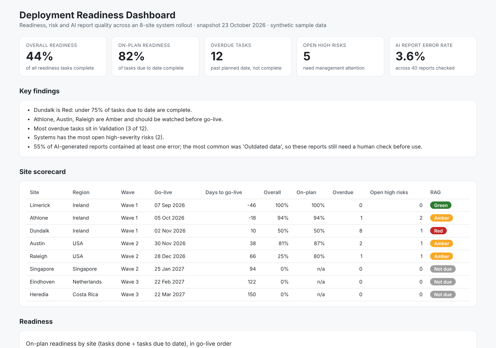

# Deployment Readiness Dashboard

An interactive dashboard that tracks whether sites are ready to go live in a multi-site system rollout. It shows readiness by site and workstream, overdue tasks, open risks, and how accurate AI-generated status reports are.

**[View the live dashboard](https://nitishkumarnaik.github.io/deployment-readiness-dashboard/)**



## Why I built it

Large rollouts (new systems, processes or sites) usually fail on readiness, not on the technology. Managers need one view that answers three questions quickly:

1. Which sites are on track for go-live, and which need attention?
2. Where are the blockers: which workstreams and which risks?
3. Can we trust the AI-generated status reports, or do they still need a human check?

## What it shows

| Section | What it answers |
|---|---|
| KPI cards | Overall readiness, on-plan readiness, overdue tasks, open high risks, AI report error rate |
| Key findings | Plain-English summary generated from the data |
| Site scorecard | Go-live date, days to go-live, readiness, overdue tasks, open high risks and a RAG status per site |
| Readiness charts | On-plan readiness by site, and completion by workstream × site |
| Risks | Open risks by workstream and severity |
| AI report checks | Error rate of AI-generated reports over time, and the most common error types |

**Two readiness measures.** "Overall readiness" counts every task, so sites with a late go-live always look behind. "On-plan readiness" only counts tasks that were due by the snapshot date, which gives a fairer view of whether a site is on track.

**RAG rule:** Green = on-plan ≥ 90% and no open high risks · Amber = on-plan ≥ 75% · Red = below 75% · Not due = no tasks due yet.

## Findings from the sample data

- Dundalk is **Red**: only 50% of the tasks due so far are complete, with 8 overdue tasks, 10 days before go-live.
- Athlone, Austin and Raleigh are **Amber**.
- Validation has the most overdue tasks, and Systems has the most open high-severity risks.
- 55% of AI-generated reports contained at least one error, most often outdated data, so they still need a human check before they are shared.

## Data

`data/Deployment_Readiness_Sample_Data.xlsx` has four tables, linked on `SiteID`:

| Table | Rows | Contents |
|---|---|---|
| Sites | 8 | Site, region, rollout wave, planned go-live date |
| ReadinessTasks | 128 | Tasks across 5 workstreams (Training, Process, Systems, Data Migration, Validation) |
| Risks | 33 | Risks with severity, status and dates |
| AI_Report_Checks | 40 | AI-generated reports checked, claims checked, errors found and error type |

All data is **synthetic** and was generated with `src/generate_data.py`. Site names are generic cities and do not represent any real company.

## Tools

- **Python:** pandas for data preparation, Plotly for the interactive charts
- **Power BI:** `powerbi/measures.dax` has the DAX measures to rebuild the same dashboard in Power BI
- **Excel:** source data model

## Run it yourself

```bash
pip install -r requirements.txt
python src/generate_data.py      # optional: regenerate the sample data
python src/build_dashboard.py    # writes docs/index.html
```

Open `docs/index.html` in a browser.

## Project structure

```
data/      sample data (Excel)
src/       data generation and dashboard build scripts
docs/      the built dashboard (served by GitHub Pages)
powerbi/   DAX measures for a Power BI version
images/    screenshots
```

## Author

S M Nitish Kumar Naik · [LinkedIn](https://www.linkedin.com/in/nitish1naik/)
