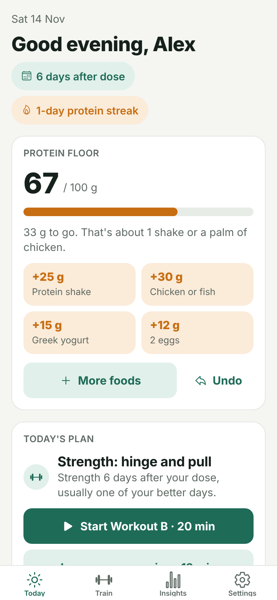
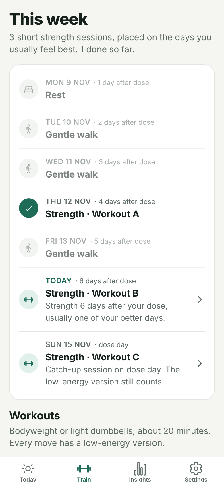
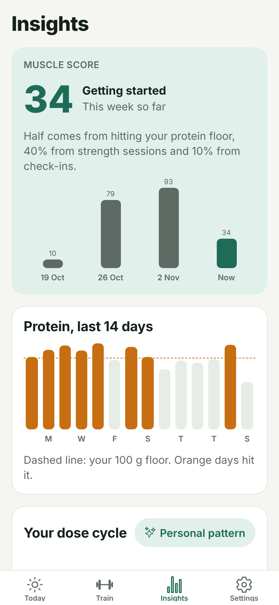

# Kept: lose the weight, keep the muscle

A cross-platform (iOS + Android) companion app for people on GLP-1 medication. It helps them protect muscle with a **daily protein floor** and **short strength sessions placed on the days they feel best**, using each person's own dose-cycle pattern.

Built with Expo SDK 58 (React Native 0.88, Expo Router, TypeScript). Local-first: no account, no server, no analytics.

| Today | Train | Insights |
|---|---|---|
|  |  |  |

## Why this app

From the market research ([docs/market-research.md](docs/market-research.md)):
- Health & fitness spending grew 13% in 2025 while installs were flat: **niche, high-intent apps win**.
- The category keeps only ~3–6% of users at day 30. They quit over **manual logging, shame and plans that ignore how they feel**.
- **GLP-1 is the strongest trend of 2026**, but existing apps are injection logs. None connect the dose cycle to protein and strength, which clinicians recommend to limit muscle loss.

Idea scoring, MVP scope, pricing and roadmap: [docs/product-spec.md](docs/product-spec.md).

## Features

- **Dose-cycle intelligence**: learns which days after a dose side effects peak (from 10-second check-ins) and schedules strength sessions on better days. It blends a typical pattern with personal data, so one bad day doesn't swing the plan.
- **Protein floor**: one-tap quick-adds, undo, a streak, and low-appetite mode.
- **Strength**: three 20-minute home workouts, each move with a low-energy version. Missed sessions move to later in the week, with no red marks.
- **Muscle Score**: a weekly 0–100 score from protein days, sessions and check-ins.
- **Clinician summary**: 14/30/90-day text summary to share.
- **Reminders**: local notifications on dose day and an evening protein check.
- Sample data mode, light/dark mode, screen-reader labels.

## Run it

```sh
cd kept-app
npm install
npx expo start        # then scan the QR code with Expo Go, or press w for web
```

## Quality checks

```sh
npm test              # 34 unit tests for the planning, cycle, score and report logic
npm run typecheck
npm run lint
```

## Project structure

```
src/
  app/                 Expo Router screens
    (tabs)/            Today, Train, Insights, Settings
    onboarding.tsx     4-step setup + "explore with sample data"
    session.tsx        workout player
    check-in.tsx, log-dose.tsx, log-weight.tsx, add-protein.tsx   (modals)
    report.tsx         clinician summary
  lib/                 pure, tested logic
    cycle.ts           dose-cycle model (cycle day, symptom profile, insights)
    plan.ts            weekly planner
    score.ts           Muscle Score
    protein.ts, report.ts, workouts.ts, dates.ts, units.ts, demo.ts
    notifications.ts   local reminders
  state/               reducer + AsyncStorage-backed store
  components/          UI kit and bar chart
__tests__/             Jest tests
docs/                  research, spec, launch guide, store copy, privacy policy
```

## Ship it

Step-by-step for both stores, including accounts, privacy forms, Google's 12-tester rule, EAS build/submit and a launch plan: **[docs/launch-guide.md](docs/launch-guide.md)**.

Before your first build, replace `com.example.kept` in `app.json` with your own identifier.

## Disclaimer

Kept is a general-wellness app, not a medical device. It does not give medical advice or recommend doses.
