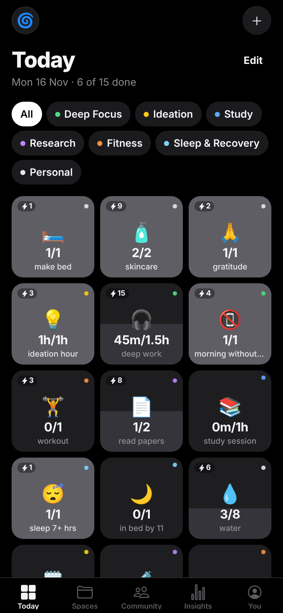
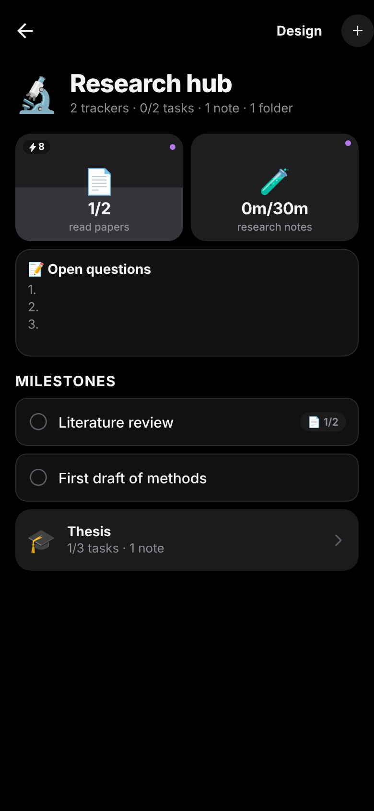
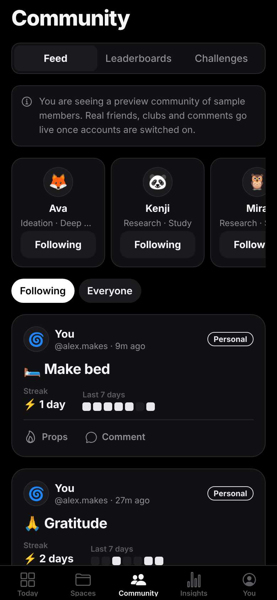
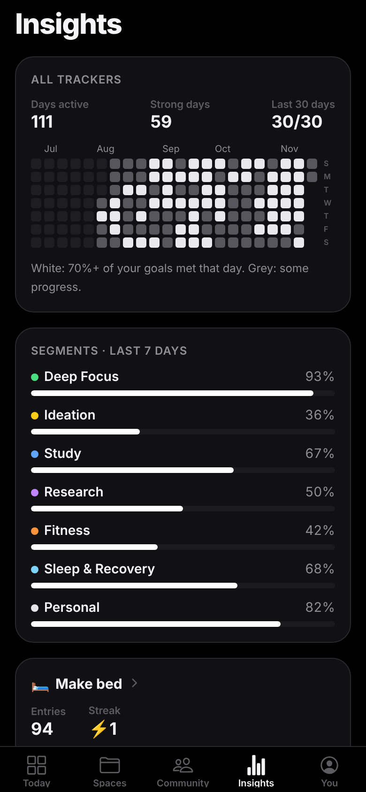
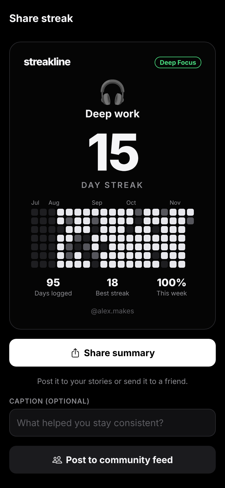

# Streakline

**Track anything. Share the streak.** A minimal tap-to-log tracker with boards you design yourself and a Strava-style community for the things people grind at outside sport: **deep focus, ideation, study, research, fitness and sleep**.

iOS + Android (+ web) from one codebase: Expo SDK 58, React Native 0.88, Expo Router, TypeScript.

| Today | Spaces | Community | Insights | Share |
|---|---|---|---|---|
|  |  |  |  |  |

## What it does

- **Tap to log.** Every habit is a tile in a 3-column grid. Done/not toggles, counts add one, time opens a focus timer. Tiles fill up as you progress and light up when the day is done; a ⚡ badge shows the streak.
- **Segments.** Deep Focus, Ideation, Study, Research, Fitness, Sleep & Recovery, plus Personal, each with ready-made trackers (e.g. *Ideation hour 1h*, *Deep work 90m*, *Read papers 2×*, *Sleep 7+ hrs*).
- **Spaces you design.** Folders of trackers, tasks, notes, headings and sub-folders. Choose list / 2 / 3 columns, reorder blocks, make them wide, nest folders. Tasks can report progress to a tracker, so ticking "Literature review" counts toward your reading streak.
- **Focus timer.** Start, pause, resume, finish and log. It keeps running if you leave the screen.
- **Insights.** Contribution grids per tracker and overall, streaks, entries, 7-day consistency per segment.
- **Community.** Finishing a public goal posts to your feed automatically (like uploading a run). Followers give **props** and comment. Weekly **leaderboards** per segment rank *consistency*, not hours. **Challenges** like *Deep Focus Week* or *30 ideation hours*.
- **Share cards.** A story-sized image of your streak and grid, shared to Instagram or a friend.
- **Privacy per tracker.** "Only me" trackers never post and never rank.

> The community runs as a clearly labelled **preview** (sample members) until accounts are switched on. The schema, security rules and sync plan for going live are in [docs/backend.md](docs/backend.md).

## Run it

```sh
cd streakline-app
npm install
npx expo start      # scan the QR code with Expo Go, or press w for web
```

On the first screen, **Explore with sample data** loads about four months of history so every screen is populated.

## Checks

```sh
npm test            # 27 unit tests: streaks, grid, timer, reducer, auto-posts, spaces, feed, leaderboards, challenges
npm run typecheck
npm run lint
```

## Structure

```
src/
  app/                    screens (Expo Router)
    (tabs)/               Today · Spaces · Community · Insights · You
    focus.tsx             deep-focus timer
    tracker/new, [id]     create / detail + edit
    space/new, [id]       space templates / board designer
    block/new, note/[id]  add blocks / note editor
    post/[id], share/[id] comments / share card
    onboarding.tsx
  components/             Tile, ContributionGrid, PostCard, TrackerForm, UI kit
  lib/                    pure, tested logic: trackers, grid, timer, segments,
                          spaces, feed, community, challenges, demo
  state/                  reducer + AsyncStorage store
__tests__/                Jest
docs/                     product plan, backend plan, launch guide
```

## Ship it

- [docs/launch.md](docs/launch.md): store accounts, identifiers, privacy forms, build and submit.
- [docs/product.md](docs/product.md): positioning, features, pricing, growth loops, roadmap.
- [docs/backend.md](docs/backend.md): accounts, real feed, leaderboards, moderation.

Replace `com.example.streakline` in `app.json` with your own identifier before the first build, and check that the name is free in both stores.
